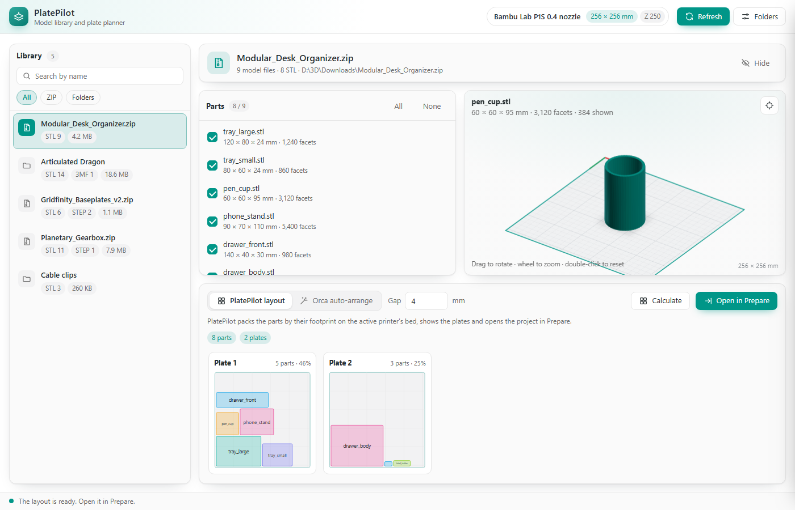
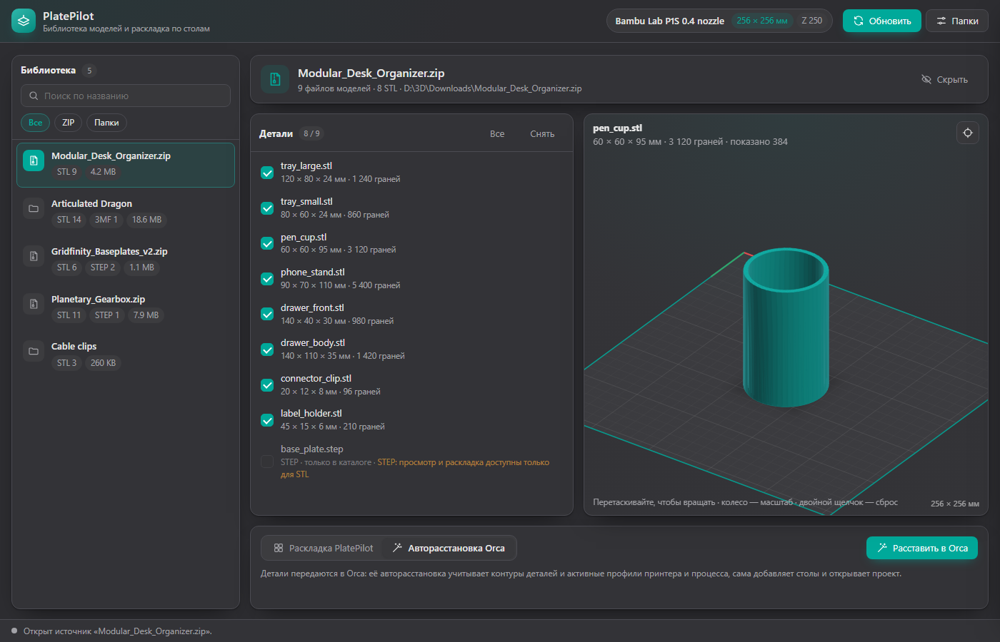

# PlatePilot for OrcaSlicer

[Русская версия ниже](#platepilot-для-orcaslicer)

PlatePilot is an [OrcaSlicer](https://github.com/OrcaSlicer/OrcaSlicer) plugin for people who download models as bundles: ZIP archives from Printables, Thingiverse or Patreon, or folders of STL files. It turns your download folders into a model library. You pick the parts you want, PlatePilot spreads them over as many plates as needed, and the project opens in **Prepare** with every plate ready.



## Features

- **Model library.** Watches folders, finds ZIP archives and unpacked folders with STL, STEP and 3MF files, and keeps the list up to date. Search, filter by type, hide sources you don't need (the files stay on disk).
- **3D preview on your bed.** A shaded preview of any STL on the bed of the printer selected in Orca.
- **Two ways to arrange:**
  - **PlatePilot layout:** packs parts by their footprint (MaxRects, six orderings, 90° rotation) with an even gap, and shows each plate with its fill percentage before you send it.
  - **Orca auto-arrange:** hands the parts to Orca's own arrange, which uses the real part outlines and your active printer and process profiles.
- **One click to Prepare.** The project opens in the window you already have: one object per part, each on its own plate, with your current printer, process and filament profiles.
- **English and Russian UI.** Follows Orca's language, or pick one in the settings. Light and dark themes follow Orca.



## Requirements

- OrcaSlicer **2.5.0** or newer. Plugins are new in 2.5 and the plugin API may still change.
- Windows has full support. On macOS and Linux everything except two features works:

| Feature | Windows | macOS / Linux |
|---|---|---|
| Library, preview, PlatePilot layout | ✅ | ✅ |
| Choose a folder in the system dialog | ✅ | paste the path instead |
| Open the project in the current Orca window | ✅ | the 3MF is saved; open it with **File > Open Project** |
| Orca auto-arrange | ✅ | not tested yet |

## Install

**From GitHub:** download `platepilot-<version>-py3-none-any.whl` from [Releases](https://github.com/GNUGiminot/platepilot-orcaslicer/releases), then in OrcaSlicer choose **Plugins > Install local plugin** and select the file.

**From Orca Cloud:** a Plugin Hub listing is planned.

## Use

1. Open the **PlatePilot** tab and click **Folders**.
2. Click **Choose folder…** or paste a folder path. Paths in quotes, as Windows Explorer's "Copy as path" makes them, are fine.
3. Click **Refresh**, pick an archive or folder, and click a part to preview it.
4. Tick the parts you want and pick a mode:
   - **PlatePilot layout:** set the gap, click **Calculate**, check the plates, then click **Open in Prepare**.
   - **Orca auto-arrange:** click **Arrange in Orca**.
5. If Prepare already has models, Orca asks what to do with the file. Choose **Open as project** to keep the plates. **Import geometry** adds the parts to your current project without the plates.

Slice again before printing, and check Orca's warnings for parts outside a plate.

## Permissions and privacy

PlatePilot works only with local files. It does not use the network.

- It reads the folders you add and the archives inside them. OrcaSlicer's plugin audit may ask you once for access to these files. PlatePilot does not bypass these prompts.
- It writes projects only to its own plugin data folder.
- **Orca auto-arrange** starts Orca's command-line mode (`orca-slicer --arrange 1 --export-3mf`). Orca asks for permission before it runs.

## How it works

Notes for developers, from reading OrcaSlicer 2.5's source:

- Orca assigns objects to plates by position when it loads a 3MF. PlatePilot places each part inside its own plate cell of Orca's plate grid. The grid uses a gap of 1/5 of the plate size, and columns from `compute_colum_count()`.
- A 3MF without `Metadata/project_settings.config` is loaded as geometry only, and its plates are dropped. PlatePilot writes the active full configuration, with the real profile names, into the project.
- `orca-slicer --single-instance file.3mf` is rejected in 2.5 (`Invalid option`). The plugin runs inside Orca, so on Windows it sends the same `WM_COPYDATA` message to its own main window that a second Orca instance would send. If Orca gains a `Plater.open_project()` plugin API, PlatePilot uses that instead.

## Development

```bash
python -m unittest discover -s tests   # tests (no OrcaSlicer needed)
python build_wheel.py                  # writes dist/*.whl
```

The plugin is the single file `platepilot.py`. Every user-facing string lives in its `STRINGS` table in English and Russian. To add a language, add a column to the table and a code to `LANGUAGES`.

Publishing a GitHub release builds the wheel and uploads it to Orca Cloud through `.github/workflows/publish-orcacloud.yml`. The upload runs only after the repository is connected to the plugin in Orca Cloud and the repository variable `ORCACLOUD_PUBLISH` is set to `true`.

## License

[MIT](LICENSE) © 2026 GNUGiminot

---

# PlatePilot для OrcaSlicer

PlatePilot — плагин для [OrcaSlicer](https://github.com/OrcaSlicer/OrcaSlicer) для тех, кто скачивает модели наборами: ZIP-архивами с Printables, Thingiverse и Patreon или папками STL. Плагин превращает папки загрузок в библиотеку моделей. Вы выбираете нужные детали, PlatePilot раскладывает их на столько столов, сколько нужно, и проект открывается во вкладке **«Подготовка»** со всеми столами.

## Возможности

- **Библиотека моделей.** Следит за папками, находит ZIP-архивы и распакованные папки с STL, STEP и 3MF и держит список актуальным. Поиск, фильтр по типу, скрытие ненужных источников (файлы остаются на диске).
- **3D-просмотр на вашем столе.** Затенённый предпросмотр любой STL на столе принтера, выбранного в Orca.
- **Два способа раскладки:**
  - **Раскладка PlatePilot:** укладывает детали по габаритам (MaxRects, шесть порядков, поворот на 90°) с равным зазором и показывает каждый стол с процентом заполнения.
  - **Авторасстановка Orca:** передаёт детали встроенной авторасстановке Orca, которая учитывает настоящие контуры деталей и ваши активные профили принтера и процесса.
- **Один клик до «Подготовки».** Проект открывается в уже открытом окне Orca: каждая деталь отдельным объектом на своём столе, с текущими профилями принтера, процесса и материала.
- **Интерфейс на русском и английском.** Язык берётся из Orca или выбирается в настройках. Светлая и тёмная тема — как в Orca.

## Требования

- OrcaSlicer **2.5.0** или новее. Плагины появились в 2.5, их API ещё может меняться.
- Windows поддерживается полностью. На macOS и Linux работает всё, кроме двух функций: выбор папки через системный диалог (вставьте путь вручную) и открытие проекта в текущем окне (3MF сохраняется, откройте его через **«Файл → Открыть проект»**). Авторасстановка Orca на macOS и Linux пока не проверялась.

## Установка

**С GitHub:** скачайте `platepilot-<версия>-py3-none-any.whl` в разделе [Releases](https://github.com/GNUGiminot/platepilot-orcaslicer/releases), затем в OrcaSlicer выберите **Plugins → Install local plugin** и укажите файл.

**Из Orca Cloud:** листинг в Plugin Hub планируется.

## Как пользоваться

1. Откройте вкладку **PlatePilot** и нажмите **«Папки»**.
2. Нажмите **«Выбрать папку…»** или вставьте путь. Путь в кавычках, как из «Копировать как путь» в Проводнике, тоже подойдёт.
3. Нажмите **«Обновить»**, выберите архив или папку, щёлкните деталь для предпросмотра.
4. Отметьте нужные детали и выберите режим:
   - **Раскладка PlatePilot:** задайте зазор, нажмите **«Рассчитать»**, проверьте столы и нажмите **«В «Подготовку»»**.
   - **Авторасстановка Orca:** нажмите **«Расставить в Orca»**.
5. Если в «Подготовке» уже есть модели, Orca спросит, что сделать с файлом. Выберите **«Открыть как проект»**, чтобы сохранить столы. **«Импорт геометрии»** добавит детали в текущий проект без столов.

Перед печатью нарежьте проект заново и проверьте предупреждения Orca о деталях за границами стола.

## Доступ и приватность

PlatePilot работает только с локальными файлами и не обращается к сети. Он читает добавленные папки и архивы в них (аудит плагинов Orca может один раз спросить разрешение) и пишет проекты только в свою папку данных. Режим «Авторасстановка Orca» запускает Orca в режиме командной строки, Orca спросит разрешение.

## Лицензия

[MIT](LICENSE) © 2026 GNUGiminot
